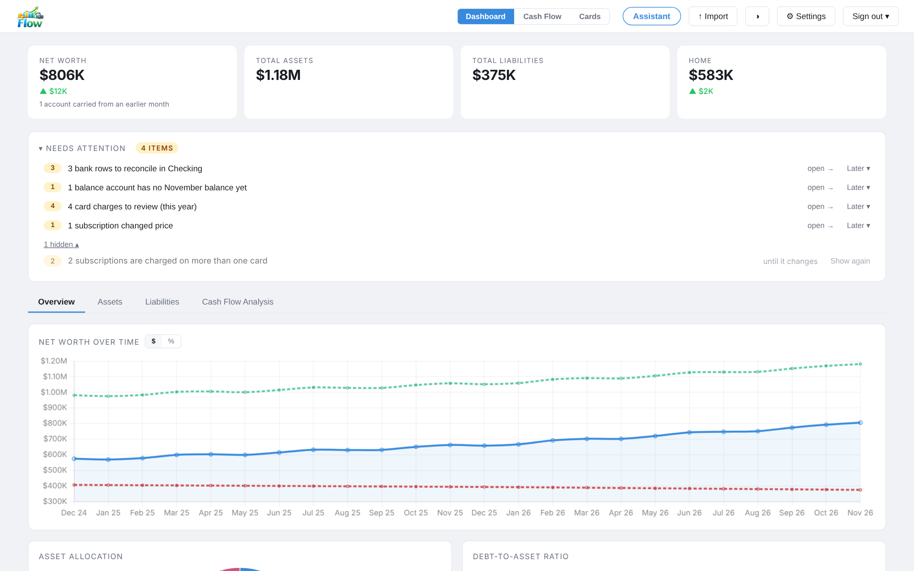
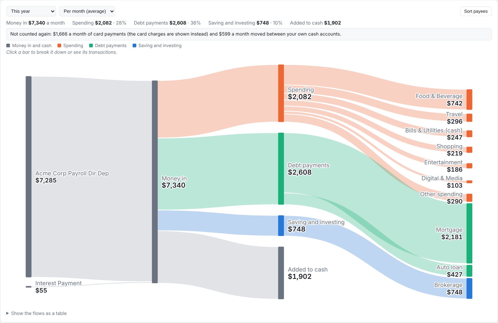
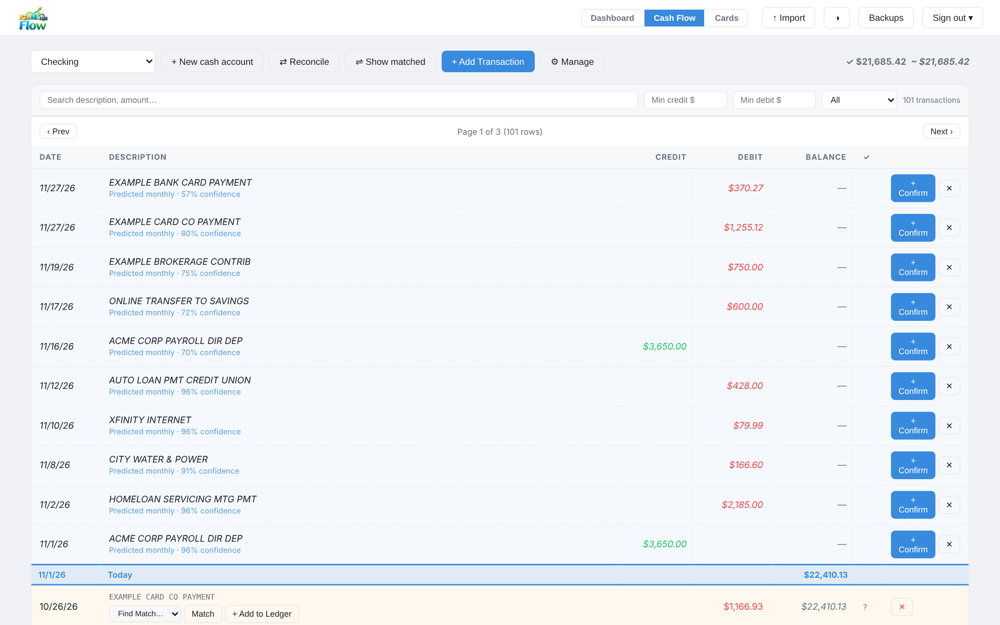
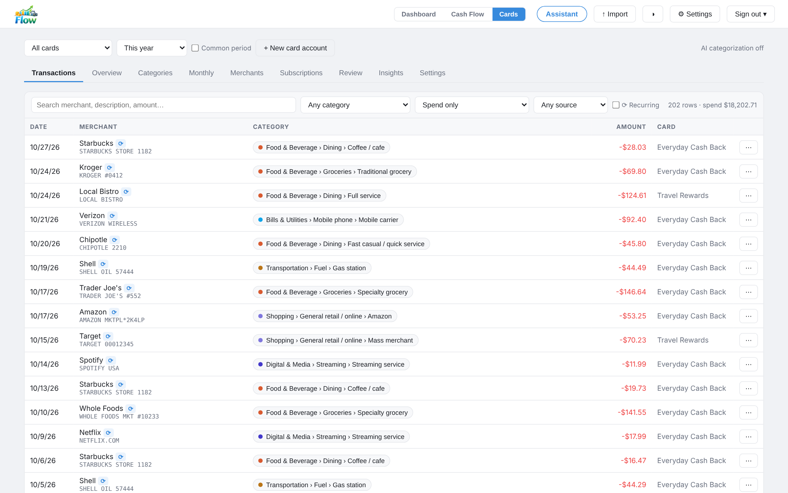
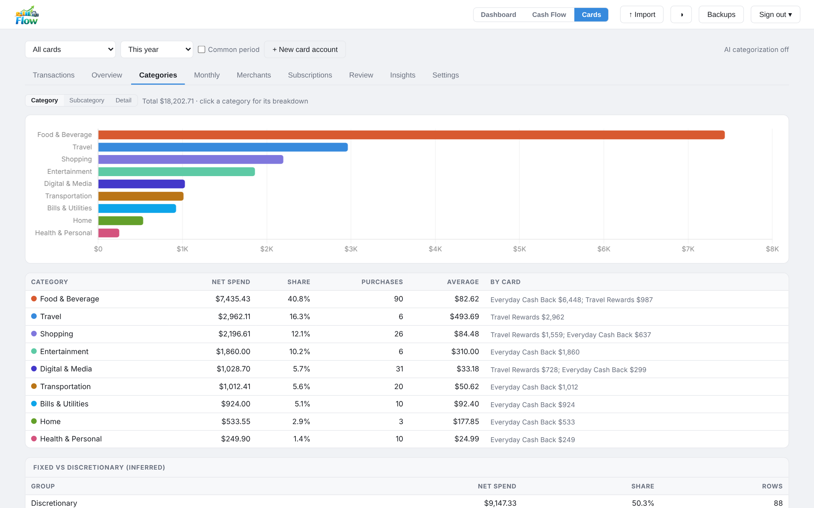
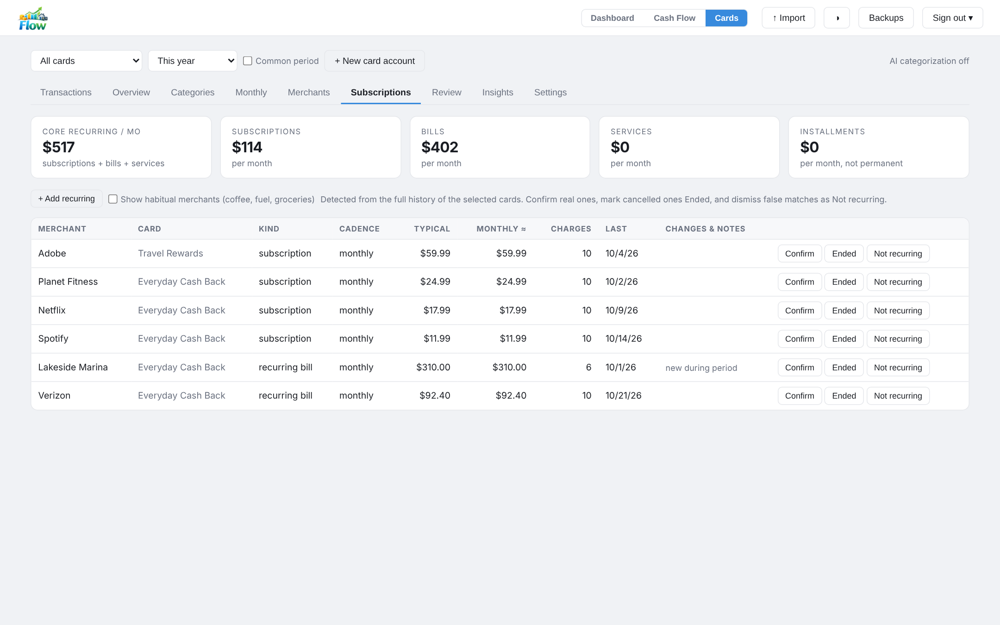
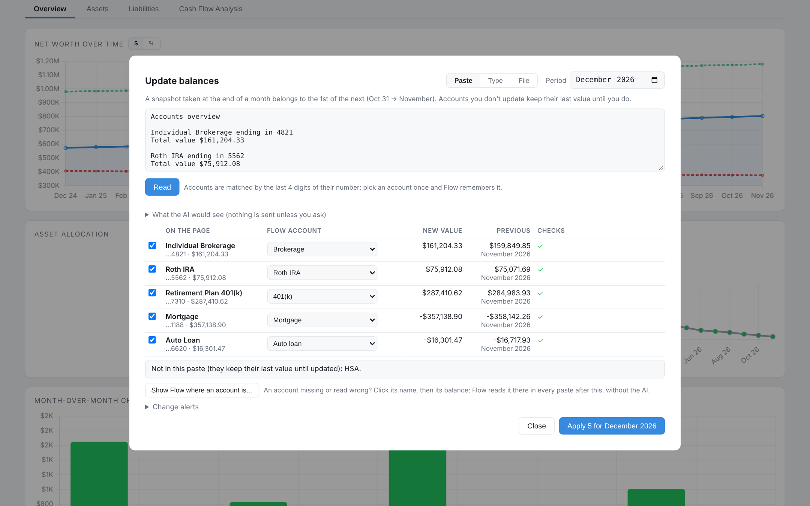
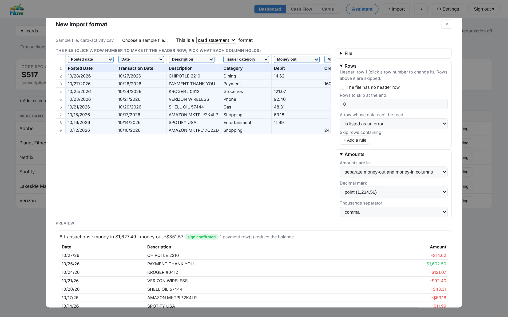

# Flow

A self-hosted personal finance dashboard. Track net worth over time, manage investments and liabilities, and run a full cash flow register with bank import and reconciliation.

Flow is built for one person or one household running it on their own machine or home server, on a private network: one shared password, no user accounts, and your data in a PostgreSQL database you control. It is not designed to be exposed to the internet (see [Security](#security)). It reads any bank's or card issuer's CSV, TSV or XLSX export through import formats you set up once per layout, so no particular bank is assumed. Amounts are shown in US dollars, and the optional AI features use the Anthropic API with your own key.



<sub>All screenshots show synthetic demo data.</sub>

## Quick start

You need Docker with Compose v2 and `openssl` (see [Requirements](#requirements)).

```bash
git clone https://github.com/rwakeham/flow.git flow
cd flow
./setup.sh
```

`setup.sh` generates the database password and secret key, picks a free port, asks for a dashboard password, offers to add your Anthropic API key for the optional AI features (press Enter to skip; **Settings → AI** takes it later, with the models and other AI settings), then builds and starts Flow and prints its URL. Open it, sign in, and:

1. **Add your accounts.** Cash accounts (checking, savings) under **Cash Flow → + New cash account**; credit cards under **Cards → + New card account**; investments, property and loans with **+ New balance account** at the bottom of the Dashboard.
2. **Import a statement.** **↑ Import** in the top bar, pick the account and choose your bank's CSV, TSV or XLSX export. The first file of each layout opens the format editor with a suggested mapping; check it and save, and later files from that bank import straight away.
3. **Update balances each month** by pasting your bank's account summary page, typing values or importing a holdings export.

Change the password under **Settings → Account** and the AI settings under **Settings → AI**; run `git pull && ./deploy.sh` to update (see [Deploying Updates](#deploying-updates)). Keep Flow on a private network (see [Running it safely](#running-it-safely)).

## Features

**Dashboard**
- Net worth chart with month-over-month history
- Asset allocation breakdown (investments, real estate, cash, etc.)
- Liability tracking
- **Update balances** by typing them, pasting your bank's account summary page or importing a holdings export (see below); each account keeps its last value until you update it, so a half-entered month never dips
- Balance-sheet accounts with their account numbers (last 4 digits), an archive flag for closed accounts, and change alerts
- Accounts marked as "ignored" are excluded from charts
- **Cash Flow Analysis** tab: a Sankey of where the money went for a period (this year by default; per month or totals): money in by payee, then spending (card charges by category plus spending paid from checking), debt payments, saving and investing, and what was added to or drawn from cash. Card payments and transfers between your own accounts are found automatically and not counted twice. **Sort payees** gives each register payee a role once (suggestions come from those matches and the payee's name); anything without one shows as "Not sorted yet". Click Spending, Debt payments or Saving and investing to break it down (categories, then subcategories or payees); click any other bar to list the transactions behind it, and edit a card charge's category right there. A payment called a "transfer" that didn't arrive in one of your cash accounts is left for you to sort (usually saving or investing) rather than dropped. The Assistant can explain a month and propose payee roles



**Cash Flow Register**
- Multiple named register accounts (e.g. Checking, Savings)
- Manual transaction entry with description autocomplete from prior transactions
- Import bank statements (CSV, TSV or XLSX from any bank) with an **import format** you set up once per layout (see [Import formats](#import-formats))
- Running balance column (Quicken-style: balance updates on every row)
- Reconciliation: match bank-imported rows to manual ledger entries
- Bulk reconcile: select multiple bank rows and add or delete in one action
- Duplicate a manual transaction to quickly enter similar entries
- "Today" marker row so you can see where the current date falls relative to transactions
- Balance cutoff: set a cutoff date + balance to hide older transactions
- Default account: one account auto-selected when you open the register



**Credit Cards**
- Upload-only card accounts: import any issuer's CSV, TSV or XLSX export with an import format; no manual entry
- Kept off the dashboard: card spending never changes net worth or the charts (add a card as a balance-sheet liability if you want its balance in net worth)
- Whether a charge is written as a negative or a positive number is part of the format and checked on every import (payment rows, running balance, transactions already on file); re-imports and overlapping downloads add only new rows
- Every transaction categorized into a three-level taxonomy: local rules first (general merchant rules plus about 400 common US brands), then Claude for merchants the rules do not recognise, if you've added an API key
- Spelling-tolerant: `CIRCLE K`, `CIRCLEK`, `CIRCLE_K` and `CIRCLE-K` are one merchant, and a truncated or extended name reuses a stored category, so each merchant is looked up once
- Fix a merchant in one dialog: click a transaction's category to change its name, parent brand and category, for that transaction only or for every transaction from that merchant (and future imports)
- **Your own subcategories and details** under Flow's categories (e.g. Entertainment › Pottery classes), from Cards → Settings, the "＋ New subcategory…" choice in any category list, or the Assistant. Each has settings Flow uses: fixed, essential or discretionary; whether its charges are usually bills, subscriptions or everyday habits; a rewards bucket; and whether the AI may see the name (private ones are sent as "(private)"). Rename one or delete it by choosing where its charges go
- **Rename any subcategory or detail**, Flow's built-in ones included (Cards → Settings → Rename a category, or ask the Assistant): charges, merchants, amount rules and future imports follow, and a built-in keeps how it behaves (rewards bucket, bill and subscription detection). Restore the original name any time. Top-level categories are fixed
- **Move everything** filed under a subcategory or detail into another in one step (from the Assistant): charges move and each merchant is remembered there, so future imports follow
- **Categories by amount**, for merchants that sell more than one kind of thing. On a category's page the rule covers every merchant in a subcategory (e.g. Fuel under $20 → convenience store, at every gas station); on a merchant's page it covers that merchant (e.g. Circle K $90 and over → car wash), and a merchant's own rules come first. Several non-overlapping ranges each, with a preview of the charges a rule covers; charges outside every range keep their category, charges you changed on their own are kept, and future imports follow the rules
- A page for every merchant (click its name anywhere): totals, monthly trend, cards, recurring status with Confirm / Ended / Not recurring, how each statement spelling was recognised (including what was sent to the AI), and its transactions
- Subscriptions and recurring charges detected, with price changes, possibly-stopped and duplicate-across-cards flags; each card's series is judged on its own, a single charge is never called recurring, and Confirm / Ended / Not recurring apply to one card
- A subscription that moves to another card (same merchant, about the same amount, next charge on time) is followed as one series, not flagged as ended or duplicated
- **+ Add recurring** (Subscriptions tab, a merchant's page, or **Track as recurring…** on any charge) for subscriptions Flow can't separate on its own, such as Kindle Unlimited billed as "Amazon": charges from that merchant within an amount range become their own series. Habitual merchants (groceries, fuel, Amazon shopping) are hidden unless you ask for them
- A series with no charge for about 1.6 billing periods is flagged overdue (still counted); after about two missed charges, or when you mark it **Ended**, it moves to an Ended list and stops counting toward recurring totals. A new charge brings it back
- Analytics: overview with coverage and common period, categories (click one for its subcategories, top merchants, monthly trend and largest purchases, plus trips and travel brands for Travel and dining vs groceries for Food), monthly trends, merchants and concentration, review list, CSV export
- AI insights: a short findings report written from aggregate totals only







**Assistant**
- An **Assistant** button in the top bar opens a chat panel for questions about your card spending and cash accounts ("Where can I easily trim spending?", "Why was September so high?", "What's coming out of checking this month?"); suggestions follow the page you're on
- It can also organize things: "Maple Street Studio is my pottery class, not shopping. Put it somewhere sensible." Changes come back as **proposals** (a new subcategory with its settings, a merchant's category or name, a rule by amount, a recurring charge) that you **Apply**, **Dismiss** or edit in Flow; nothing changes until you apply it
- Answers come only from Flow's data: Claude looks up summaries Flow computes, quotes their numbers, and flags any number it can't find in the data; each answer links to the pages it used
- "Where can I trim?" follows Flow's own ranked list: subscriptions, delivery, card fees, small frequent purchases, merchants you're spending more at, dining out and other discretionary categories
- A count of questions asked this month (and last month); there is no limit
- Attach a statement file (📎 or drag and drop) and it proposes an import format for it; it sees only the file's column shapes and cleaned headers, never a value, and the proposal opens in the format editor for you to check and save
- The conversation lives only in the browser tab; New chat clears it

**Privacy of AI features.** Every request and response is logged in full (the data sent, the whole request, and the whole reply) in the **AI privacy log** (**Settings → AI** in the top bar, which also shows the model each feature uses). Categorization sends only sanitized merchant names (store numbers, phone numbers, cities, cardholder names and other identifiers removed), the issuer's category label and the payment processor. It never sends amounts, dates, card or account details, or full descriptions. Each merchant is sent once and the answer is cached. Insights send aggregate tables with cards renamed "Card A", "Card B". The Assistant sends your question, the earlier messages of the chat, and summaries it looks up (totals by category, merchant, month and so on), with cards and cash accounts renamed "Card A", "Account A" and merchant names cleaned; transfers to people keep only the service ("Zelle transfer"). Single transactions (date, cleaned merchant, amount, category) are sent only for questions about specific charges, at most 25 at a time. An attached file is sent only as its outline: per column, a type (date, money, text and so on) and the header with every word outside a small vocabulary replaced by `~`. Names Flow can't recognise as names, such as a payee you typed by hand, may be sent; add them to the extra redact words under **Settings → AI** to withhold them. Without an API key nothing is sent at all. If the key expires or is revoked (or the account can't be billed), imports keep working, automatic AI calls pause, and the Cards page shows an "AI paused" banner until the key is replaced under **Settings → AI** (**Test the key** there makes one tiny request to check it).

**General**
- Single-password authentication with session cookie
- **⚙ Settings** in the top bar: AI (key, models, privacy log), Backups, Updates (version, check now, the daily switch) and Account (change the password); **Sign out ▾** signs out here or everywhere
- Dark mode support
- Fully self-hosted: no accounts or telemetry, and the one call Flow makes on its own, a daily check for a newer release, can be switched off (see [What leaves your machine](#what-leaves-your-machine))

## What leaves your machine

- **Nothing about your data, unless you turn on AI.** Without an Anthropic API key (entered under **Settings → AI**, or by `setup.sh` for the first start), Flow makes no outside calls with your data. With a key, the AI features send what the privacy paragraph above describes to the Anthropic API, and every request and response is logged in the **AI privacy log** (**AI** in the top bar). The **AI calls on** switch there turns the calls off while keeping the key.
- **No outside scripts.** The charting library (Chart.js, MIT) ships with Flow in `frontend/static/vendor`, so the browser loads everything from your server.
- **A daily check for a newer release.** Once a day Flow asks GitHub (`api.github.com`) for its latest release and, when it is newer than the one running, shows it under **Settings → Updates**: a dot on the Settings button, and in that section the version with a link to the release notes. Nothing about you or your data is sent; GitHub sees the request as it would any visit to the site, from your server's address. **Check for updates** there runs it by hand, and the same section turns the daily check off (or set `FLOW_UPDATE_CHECK=0` in `.env`). Flow never installs an update itself: that stays `git pull && ./deploy.sh`.
- **Nothing else**: no analytics, no error reporting.

## Security

**Flow is meant to run on a private, limited-access network**, such as a home network, or to be reached from outside only through a VPN or an HTTPS reverse proxy you control. It is not built to face the public internet directly. Several of its design decisions rely on that:

- **One shared password, one user.** There are no accounts, roles or audit trail; anyone with the password sees and can change everything.
- **Plain HTTP by default.** Traffic, including the password and session cookie, is encrypted only if you put Flow behind HTTPS.
- **Defense in depth over completeness.** The app runs as an unprivileged user with request, file and backup size limits, security headers and a login throttle, but some container hardening and base-image findings are accepted as low risk on a private network.
- **Your data in plain form on your server.** The database and the backup files on the server aren't encrypted by Flow; protect the host. A copy you download can be encrypted under a passphrase (**↓ encrypted** in **Settings → Backups**) for keeping somewhere else.

[SECURITY.md](SECURITY.md) summarizes the security model and its accepted risks, and explains how to report a vulnerability.

## Running it safely

- **Keep it private.** Flow listens on `APP_PORT` (8000 by default) on every network interface of the host. Use it on your home network, or reach it from outside through a VPN (WireGuard, Tailscale) or a reverse proxy with HTTPS. Don't forward the port straight to the internet.
- **Behind a reverse proxy** (Caddy, nginx, Traefik): serve it over HTTPS, set `COOKIE_SECURE=true` so the session cookie is only sent over HTTPS, and set `FLOW_TRUSTED_PROXIES` to the proxy's address so failed logins are limited per real client (5 failures per 5 minutes) rather than for everyone behind the proxy. Pass the `Host` header through (or send `X-Forwarded-Host`): Flow compares a change request's origin with it for browsers that don't send `Sec-Fetch-Site`.
- **One password.** Anyone with it sees everything. Choose a long one; `setup.sh` can change it later, and changing it signs every browser out. **Sign out** ends that browser's session (a copy of its cookie stops working too); **Sign out ▾ → Sign out everywhere** ends every session without a password change, for a lost device or a browser you forgot to sign out of.
- **If the login lock trips on its own.** Failed logins are counted per client address. On Docker Desktop (Mac and Windows), and for connections that reach the container through Docker's userland proxy (IPv6, `localhost`), every device on your network can arrive from the same internal address, so five wrong passwords from any one of them lock everyone out for five minutes. Set `FLOW_TRUSTED_PROXIES` to that address range (for example `172.16.0.0/12`) only if a reverse proxy in front of Flow sends `X-Forwarded-For`; otherwise the lock simply clears itself after five minutes, and keeping Flow on a network you trust is the fix.
- **Other web apps on the same host name.** Flow refuses a change request that the browser says came from another origin, including another port on the same host, so a page from another app on the machine can't act with your cookie. Reads need the password either way.
- **Backups hold everything.** A backup zip (**Settings → Backups**) contains all your data in plain JSON. Flow takes one every day (03:00 UTC by default) and before the first import of a day, keeping the newest 30 automatic ones; backups you take or upload stay until you delete them. Store downloads somewhere you'd keep bank statements, or download the encrypted copy: it is AES-GCM under a key derived from your passphrase, which Flow never stores, so a lost passphrase means an unreadable file.
- **Updates.** `git pull && ./deploy.sh` (below). Flow tells you under **Settings → Updates** when a newer release exists (the daily check above). Security fixes land on `main`; see [SECURITY.md](SECURITY.md) to report a problem.

## Scope and limits

- **US dollars.** Amounts are formatted as USD; there is no currency setting. Import formats read other date orders and decimal marks, but the totals are shown with `$` and dates are shown US-style (month first).
- **US merchants.** The local categorization rules know about 400 common US brands; elsewhere more merchants go to the AI (or to you). A purchase counts as "foreign" when the card export says it was outside the US, which matters for the Review tab if your card isn't a US one.
- **English pages, dollar amounts.** Pasted account summaries are read from English wording ("ending in 1234", "balance", "closed"). Paste markers (teach Flow where a balance is once) work whatever the wording, but both need amounts written with `$`; for a page in another currency, type the values or import a balance file.
- **CSV, TSV and XLSX only.** There is no OFX, QFX or QIF import: export CSV from your bank. Column headers are recognised in English; a file in another language is read by column position, which you check in the format editor. Amounts written with a "DR" / "CR" suffix ("45.10 DR") can't be read.
- **Single user.** One password and no roles or audit trail.
- **File size.** An import file can be up to 10 MB and 50,000 rows; split a longer history into several date ranges.

## Requirements

- Docker with Compose v2 (`docker compose`); the legacy v1 `docker-compose` is not supported. Flow runs only in its containers: there is no way to run it without Docker
- `openssl` (for secret generation during setup)
- Optional: replace `frontend/static/logo.png` (the header logo) with your own

## First-time Setup

```bash
git clone https://github.com/rwakeham/flow.git flow
cd flow
./setup.sh
```

`setup.sh` will:
1. Check for Docker, Compose v2 and a running Docker daemon
2. Generate a random database password and secret key and save them to `.env` (if a database volume already exists, it asks for the original password instead)
3. Find a free port (default 8000) and save it to `.env`
4. Prompt you to set a dashboard password (any characters, spaces included). It is used for the first start; Flow then keeps it itself, as a hash in its database
5. Offer to add your Anthropic API key (typed hidden) for the optional AI features. Press Enter to skip; the key, the model for each feature, the on/off switch and the words to strip from merchant names are all set under **Settings → AI**, and without a key nothing is ever sent
6. Hand off to `./deploy.sh`, which builds and starts the containers, waits for them to be healthy and prints the URL

Re-running `setup.sh` is safe: it keeps your existing secrets and offers to reset the password or set a key from there. Once Flow has started, those two values and the AI settings live in Flow's database and are managed in the app; `setup.sh` offers to remove any still in `.env`, where they would be copied in again at every start and win while they stay (which is also how a forgotten password is reset: set `FLOW_PASSWORD` in `.env`, run `./deploy.sh`, then remove it). From the host, `docker compose exec app python reset_password.py` does the same without touching `.env`.

## Deploying Updates

```bash
git pull
./deploy.sh              # build, start and health-check the checkout as it is
./deploy.sh --no-cache   # the same, rebuilding the images from scratch
```

`deploy.sh` never touches git: it deploys whatever is checked out, so update the checkout first. It prints the version it deploys. The Python and Postgres images are pinned to exact versions in the repository, so a `git pull` is also how their security updates arrive. It rebuilds the image, restarts the containers and waits for the database and the app to pass their health checks. Run it again after editing `.env`; a container restart does not re-read it.

`deploy.sh` (and the app itself) refuses a `SECRET_KEY` shorter than 32 characters and the example values from `.env.example`; `./setup.sh` replaces them. Changing the password signs every browser out. The app runs as an unprivileged user; a one-off `backups-owner` step on every deploy makes sure it owns the backup volume, so its exited container in `docker compose ps -a` is expected.

## Versions and releases

Flow's version (`MAJOR.MINOR.PATCH`) is shown under **Settings → Updates** and printed by `deploy.sh`. Each release is listed on the [Releases page](https://github.com/rwakeham/flow/releases) with what changed.

- **Know when there is one**: Flow checks GitHub once a day and, when a newer release exists, puts a dot on **Settings**; **Settings → Updates** shows the version with a link to its notes. **Check for updates** there asks right away, **hide** keeps a release quiet until the next one, and the same menu turns the daily check off. Flow never updates itself.
- **Follow `main`**: `git pull && ./deploy.sh`. Every merge to `main` passes the tests and the privacy check; releases are tagged points on it.
- **Stay on one release**: `git fetch --tags && git checkout v3.0.0 && ./deploy.sh`. Go back to following releases with `git checkout main && git pull && ./deploy.sh`.
- **Read the notes before a new major version** (3.x to 4.0): a major version is one that asks something of you, such as a new `.env` setting. Patch and minor releases (fixes and features) never do. Back up first anyway (**Backups** in the top bar).

Issues and pull requests are welcome.

## Environment Variables

Stored in `.env` (created by `setup.sh`, never committed):

| Variable | Description |
|---|---|
| `POSTGRES_PASSWORD` | Password for the PostgreSQL database |
| `FLOW_PASSWORD` | Password to log in to the dashboard, for the first start (Flow keeps it afterwards; see below) |
| `SECRET_KEY` | Secret used to sign session cookies |
| `APP_PORT` | Host port the app listens on (default: 8000) |

The dashboard password, the Anthropic API key and the AI settings live in Flow's database once it has started (the password as a hash, the key encrypted under `SECRET_KEY`), so they are not environment variables and `docker inspect` doesn't show them. `FLOW_PASSWORD` is for the first start. The optional variables below still work, as `setup.sh` writes `ANTHROPIC_API_KEY` for a first start: a value set in `.env` is copied into Flow at every start and wins while it stays there, so the **AI** dialog shows it as set by `.env` and won't change it. Remove the line to manage the value in the app.

| Variable | Description |
|---|---|
| `ANTHROPIC_API_KEY` | The Anthropic API key (otherwise entered under **Settings → AI**) |
| `FLOW_AI_MODEL` | Claude model for every AI feature (default: `claude-sonnet-5-5`) |
| `FLOW_AI_MODEL_CATEGORIZE` | Model for merchant categorization only, e.g. `claude-haiku-5-5` (default: `FLOW_AI_MODEL`) |
| `FLOW_AI_MODEL_ASK` | Model for the Assistant only (default: `FLOW_AI_MODEL`) |
| `FLOW_AI_REDACT` | Comma-separated extra words removed from merchant names before any AI call |
| `FLOW_AI_ENABLED` | `0` turns AI calls off even when a key is set (default: enabled) |
| `FLOW_UPDATE_CHECK` | `0` turns the daily check for a newer release off (default: enabled) |
| `FLOW_BACKUP_DAILY` | `0` turns the daily backup off (default: enabled) |
| `FLOW_BACKUP_KEEP` | How many automatic backups to keep, newest first; `0` keeps all (default: 30) |
| `FLOW_BACKUP_HOUR` | UTC hour the daily backup is taken at or after (default: 3) |

**Editing `.env` by hand.** `setup.sh` writes every value in double quotes, with `\`, `"` and `$` escaped by a backslash (`FLOW_PASSWORD="pa\$word #1"`), so Docker Compose reads it exactly as typed. Do the same for any value with spaces, `$`, `#` or quotes: unquoted, Compose treats `$name` as a variable and ` #` as the start of a comment. `.env` holds your passwords and keys; `setup.sh` makes it readable by your user only (`chmod 600 .env`), and `deploy.sh` warns if it isn't.

Optional, not written by `setup.sh`:

| Variable | Description |
|---|---|
| `COOKIE_SECURE` | `true` marks the session cookie `Secure`; set it when serving over HTTPS (default: `false`) |
| `FLOW_TRUSTED_PROXIES` | Your reverse proxy's IP or range (e.g. `172.16.0.0/12` for one on a Docker network), comma-separated, so failed logins are counted per real client rather than per proxy (default: none) |
| `FLOW_RECURRING_SUBSTREAMS` | `0` disables recurring-transaction substream detection (default: enabled) |

## Architecture

```
flow/
├── backend/              # FastAPI application
│   ├── main.py           # App entry point, lifespan migrations
│   ├── VERSION           # Flow's version (the only place it is written)
│   ├── models.py         # SQLAlchemy ORM models
│   ├── auth.py           # Session-cookie authentication
│   ├── database.py       # DB engine and session factory
│   ├── asset_versions.py # Cache-busting ?v= on the page's /static references
│   ├── cash_flow.py      # Cash Flow Analysis: payee roles, matching, the Sankey
│   ├── balance_sheet.py  # Balance entry: paste reading, AI outline, checks, carry-forward
│   ├── reconciler.py     # Bank-to-ledger match suggestions
│   ├── import_dedup.py   # De-duplication of re-imported bank statements
│   ├── import_batch.py   # Bulk import: which account each file belongs to
│   ├── recurring.py      # Recurring-transaction projection
│   ├── backup_service.py # Backup file generation, with backup id and zip size checks
│   ├── security_headers.py # Security headers on every response; same-origin check on changes
│   ├── settings_store.py # The password hash, the encrypted API key and the AI settings, in the database
│   ├── reset_password.py # Host-side password reset (docker compose exec app python reset_password.py)
│   ├── import_profile.py # Import formats: read any CSV/TSV/XLSX by a saved format, sign check
│   ├── import_profile_resolve.py # Which saved format reads a file for an account
│   ├── import_infer.py   # Drafts a format from a sample file; column outline for the Assistant
│   ├── testdata/         # Synthetic sample files, their formats and expected rows
│   ├── card_rules.py     # Card transaction types and merchant rules
│   ├── card_taxonomy.py  # Category tree derived from the rules
│   ├── card_privacy.py   # Merchant sanitization before any AI call
│   ├── card_classifier.py# Category precedence: your rules, local rules, cached AI
│   ├── card_import.py    # Card import de-duplication and classification
│   ├── card_ai.py        # Anthropic API: categorization and insights
│   ├── card_amount_rules.py # Categories by amount range
│   ├── card_recurring.py # Subscription and recurring-charge detection
│   ├── card_analytics.py # Spend analytics and the insights payload
│   ├── ask.py            # Assistant chat: topic check, lookup loop, number check
│   ├── ask_data.py       # Assistant's summaries, trim list and lookups
│   ├── ask_proposals.py  # Assistant's change proposals (checked; applied by you)
│   ├── ask_files.py      # A statement file attached in the Assistant: outline only
│   ├── test_*.py         # pytest suites
│   └── routers/
│       ├── data.py       # /api/accounts, /api/data — accounts, timeseries, summary
│       ├── balances.py   # /api/balances — paste and file reading, markers, preview, apply
│       ├── cashflow.py   # /api/cashflow — Cash Flow Analysis and payee roles
│       ├── upload.py     # /api/import — which saved formats read a file, bulk import plan
│       ├── import_profiles.py # /api/import-profiles — formats, links, draft, preview, export
│       ├── register.py   # /api/register — cash flow register
│       ├── cards.py      # /api/cards — credit cards and analytics
│       ├── ask.py        # /api/ask — Assistant chat
│       └── backup.py     # /api/backups — backups, the daily backup's settings, encrypted copies
├── frontend/
│   ├── index.html        # Single-page app (vanilla JS)
│   └── static/           # Static assets (logo, cards.js/cards.css, ask.js/ask.css, balances.js/balances.css, cashflow.js/cashflow.css, importprofiles.js/.css, accounts.css)
├── tests/
│   └── test_deploy_script.py  # deploy.sh behaviour tests (deploys nothing)
├── docs/screenshots/     # README screenshots (synthetic demo data)
├── .github/workflows/    # Tests on every pull request; the release workflow (tag and GitHub Release)
├── docker-compose.yml
├── setup.sh              # First-run setup
└── deploy.sh             # Build, start and health-check the checkout
```

**Stack:** FastAPI · SQLAlchemy · PostgreSQL 16 · vanilla JS · Docker

## Data Models

| Model | Description |
|---|---|
| `Account` | Balance-sheet account (name, type, account numbers, ignored/archived, change alert overrides) |
| `Balance` | Monthly balance for an account (1st of the month; typed, pasted or from a file) |
| `BalanceMarker` | Where an account's balance sits on a pasted summary (taught by example or saved from an AI reading) |
| `AppSetting` | Small settings table (`flow_settings`): the change alert thresholds, the AI, update-check and backup settings |
| `AppSecret` | Flow's own secrets (`flow_secrets`): the password hash, the encrypted API key; never in a backup |
| `RegisterAccount` | Cash flow register account (checking, savings, etc.) |
| `ImportProfile` | An import format: how to read one file layout (columns, dates, amounts, sign) |
| `ImportProfileLink` | Which accounts (cash, card or balance) a format imports into |
| `Transaction` | Individual register transaction (manual or bank-imported) |
| `CardAccount` | Credit card (upload-only; not on the dashboard) |
| `CardImport` | One uploaded statement file, with the format that read it and the sign rule used |
| `CardTransaction` | Categorized card transaction (charges negative) |
| `MerchantCategory` | Merchant category cache: your remembered choices and AI answers |
| `CardRecurringVerdict` | Your confirm/dismiss decision on a detected recurring merchant |
| `CardManualRecurring` | A recurring charge you added by hand (merchant, optional card and amount range) |
| `CardAmountRule` | A category for charges within an amount range, for one merchant or a whole category |
| `PayeeRole` | What a register payee's money is for in Cash Flow Analysis (income, spending, saving ...) |
| `AiRequestLog` | Every AI request and response, in full |
| `AskUsage` | Assistant questions per day, shown as monthly totals (the only thing it stores) |
| `CustomCategory` | Your own subcategories and details, with their settings |
| `CategoryRename` | Built-in subcategories and details you renamed (original name → yours) |
| `CardInsightReport` | Saved AI insight reports |

## Updating Balances

On the Dashboard, **Update balances** (also in the Assistant panel) opens a dialog for balance-sheet accounts (investments, loans, lines of credit) with three ways in:

- **Paste**: on your bank's account summary page, select all, copy, and paste. Flow reads it on its own server: each account's name, the last 4 digits of its number and its balance. Accounts are matched by their last 4 digits; the first time, pick the Flow account in the preview and Flow remembers the number. Accounts not on your balance sheet (checking already in the register, rewards points, closed loans) are listed and skipped.
- **Type**: every account with its last value; fill in the ones you have.
- **File**: a holdings or accounts export (CSV, TSV or XLSX) read with a balance import format. Rows are matched to accounts by last 4 digits, then a paste marker's label, then the exact account name; a format can add up rows for the same account (a holdings export lists one row per investment), and an "as of" column suggests the period.



Before anything is saved, the preview shows each value next to the previous one with checks: changes over the alert thresholds (a % and a $ limit, set in the dialog, overridable per account), replacing a value already stored, an older period, the same account twice, a number saved on another account. Untick anything you don't want, then **Apply**.

**Period:** balances are filed by month (the 1st). The dialog suggests the current month and you can pick another, up to next month, for a month-end snapshot you'd rather file as the month it closes.

**Teaching Flow a page it can't read.** Flow's own reader looks for wording like "ending in 1234" near an amount, which many banks don't use. For any other layout, choose **Show Flow where an account is…** in the preview: pick the account, click the line with its name, then click its balance. Flow saves that as a **paste marker** on the account (the label, the last 4 digits if they are nearby, and either "the first amount after it" or "the amount on the line saying …") and keeps it only if it finds the same amount again. Next month's paste is read with no help. An account's markers are listed (and can be deleted) in its **Edit balance account** dialog. Markers stay on your server.

**Read with AI** is offered when neither the markers nor the reader find everything. Only an outline is sent: every amount and account number is replaced by a token, and every word outside a small banking vocabulary (names, institutions) by `~`. The model only says which amount goes with which account; Flow puts the real values back. The dialog shows exactly what would be sent, and each request is logged in the AI privacy log (**AI** in the top bar). Tick **Remember where this is** on an AI-read row and applying it saves a marker, so the next paste needs no AI.

**Missing months:** an account you didn't update shows its last value (the Net Worth card says how many are carried) until you enter a new one. Archive a closed account so it stops carrying forward. Edit or delete any month from the account's **Edit** dialog under Manage Accounts. Manage Accounts shows each account's latest month and balance (and each cash account's newest transaction) and flags, even while collapsed, the accounts with nothing for this month yet (a cash account: nothing in the last 40 days).

## Import formats

Flow has no bank or card layouts built in. Every file is read with an **import format** that you set up once for a layout and link to the accounts it imports into (a format can serve several accounts, and an account can have several formats). A format says which row holds the headers, which column is the date, description, amount (one column, separate debit and credit columns, or an amount plus a column saying debit or credit), running balance, check number and so on; the date order (month, day, year or day, month, year); the decimal mark; rows to skip (pending, "Beginning balance", footers); and whether money leaving the account is written as a negative or a positive number. Files without a header row are read by column position.

**Setting one up.** The first time you import a file no format reads, Flow drafts one from the file itself and opens the **format editor**: the file's first rows with a role picker over each column, the settings beside them, and a live preview of how each row will be read, with totals in and out and any row it can't read. The preview checks the sign against a running balance column, transactions already on file or card payment rows; when nothing confirms it, it asks whether money left the account on one row. Nothing is imported until you save. You can also start from an account's dialog (**Import files → Set up from a sample file…**), or attach the file in the Assistant and let it propose the mapping (it sees only the columns' shapes and cleaned headers).



**When a bank changes its export.** Columns are found by their header text, so a reordered file still reads. If a header changes, the import stops and shows what was added and removed, and **Update format** opens the editor with the old mapping carried over. If the sign a format says contradicts the file (a running balance that only adds up the other way round), the import is refused rather than reversing every amount.

**Managing formats.** Each account dialog (**Edit cash account**, **Edit card account**, **Edit balance account**) has an **Import files** section listing its formats, with Edit, Unlink and Export, plus **Link an existing format…** and **Import format file…**. **Manage formats…** in the import dialog lists them all (edit, duplicate, export, delete, import). A format exports as a small JSON file with no transaction data, so you can share one for your bank; an imported format is marked "not tried on a file yet" until the first import check reads a file with it. Formats are included in backups.

## Bank Import

Use **↑ Import** in the top bar and pick the cash account. The dialog shows the format that reads the file (**Edit** it, or **Change** to another format linked to the account), how many rows are new, and any rows the format can't read; those keep Import disabled until you tick **Import the rest**. A format can mark its rows as bank statement lines (matched against your ledger) or as ledger entries you keep yourself, with an optional reconciled column. After import, unmatched bank rows appear in the register for reconciliation: match them to existing manual entries or use **Add to Ledger** to create one. If most of a file's rows are already in a different cash account, the dialog warns before importing.

## Credit Card Import

Create a card under **Cards → + New card account** (or pick **+ New card account…** in the import dialog), then use **↑ Import** with the issuer's export. The dialog shows the format that read the file, the statement period, the sign check and its evidence, how many rows are new, and a preview with types and categories. Many exports carry no card number, so the account you pick decides where the file goes. If most of a file's transactions are already on a different card, the dialog warns before importing and offers to switch to that card.

## Bulk Import

Select several files at once in the import dialog (bank exports, card statements and ledgers can be mixed). Flow lists each file with the account it belongs to, and only fills that in when the evidence points one way:

- its transactions already overlap exactly one account (at least 3 rows and 60% of the rows in the dates that account covers), or
- a card number in it is listed on exactly one card, or
- the format that reads it is linked to exactly one account.

A card account can list several card numbers (authorized users, a replacement card): set them under the card's settings, and every import adds the numbers its file carries. A file whose transactions match a card but whose number is new to it still matches, and the number is added; only a number already listed on a different card stops it.

Files in the same batch count as history for each other, so a run of consecutive exports chains from one that overlaps what is already stored. Everything else (no overlap, overlap with more than one account, a card number listed on a different card, an archived account) waits for you to pick, with the reason; nothing is imported until every file has an account or is skipped. A file no format reads, or whose header changed, offers **Set up format…** or **Update format…** in its row, and the plan is made again once it is saved. A card file whose sign nothing on file confirms is skipped: import it on its own to check the preview. Files go in oldest first through the normal import, which checks them again and skips rows already on file.

## Useful Commands

```bash
docker compose logs -f app   # live app logs
docker compose down          # stop everything
docker compose down -v       # stop and delete the database AND the backups volume (destructive)
docker compose cp app:/backups ./backups-copy   # copy every backup zip out of the container
```

## License

Flow is released under the [MIT License](LICENSE). To report a security problem, see [SECURITY.md](SECURITY.md).
